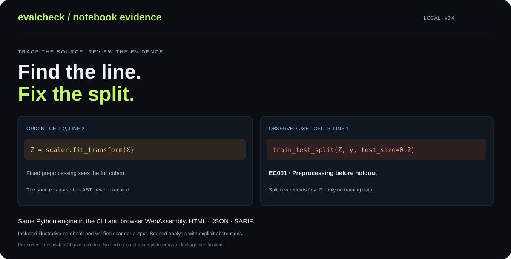

<div align="center">

# EvalCheck

### Find the line. Fix the split.

**Trace evaluation risks to the notebook line or dataset row behind them.**

[](https://github.com/Junghwan0516/evalcheck/actions/workflows/ci.yml)
[](pyproject.toml)
[](LICENSE)

**[Try the live playground](https://junghwan0516.github.io/evalcheck/) · [Quick start](#quick-start) · [Evidence & limits](#evidence-you-can-reproduce) · [한국어](README.ko.md)**

No API key · No application upload server · Zero core Python dependencies · English / 한국어



</div>

A high test score can hide a broken evaluation. EvalCheck inspects **Python/Jupyter source** for supported leakage patterns and **CSV/JSONL splits** for overlapping text, shared isolation groups and conflicting labels. It shows the source locations and original records so you can review the evaluation protocol.

Run it in your browser or your terminal. Both use the **same Python engine**. Target notebook code is parsed, **never executed**.

> **v0.5.0 pre-release.** EvalCheck supplies review evidence, not a leakage-free certification. It is not published on PyPI; install from this repository or its release. The browser needs internet for its first pinned WebAssembly runtime download. Input contents stay in the browser worker.

## Try it in 30 seconds

1. Open the **[playground](https://junghwan0516.github.io/evalcheck/)** and scan **Leaky notebook**.
2. Inspect the scaler's origin at **cell 2, line 2** and the split at **cell 3, line 1**. The example also fits a model on the test records.
3. Compare **Fixed notebook**, then try **Real public data · 3,000 rows**. Export the evidence as HTML, JSON, or code SARIF.

Use the language selector for English or Korean. Switching languages keeps your inputs and current findings. The first scan can take longer while the Python runtime loads.

## Quick start

```bash
git clone https://github.com/Junghwan0516/evalcheck.git
cd evalcheck
python -m pip install .
evalcheck scan examples/notebooks/leaky.ipynb --out my-code-audit --fail-on none
```

Open `my-code-audit/report.html`. The standalone report needs no external scripts or server.

```bash
# Inspect your own notebook directory; findings fail CI by default.
evalcheck scan notebooks --out my-notebook-audit

# Audit text splits with a question/document/patient isolation boundary.
evalcheck audit --split train=train.csv --split test=test.csv \
  --text answer --label grade --group question_id --out my-data-audit

# Generate a synthetic example, with a Korean report.
evalcheck demo --out my-demo --lang ko
```

Output directories must be empty. Audit and scan commands **still write their reports when findings trigger a policy failure**. Use `--fail-on none` for inspection without failing on findings. All four commands accept `--lang en|ko`; the CLI default is English. [Full CLI, Python API and file contract](docs/user-guide.md).

## What it catches

| Source code rule | Review evidence |
| --- | --- |
| EC001 | Fitted preprocessing flows into a later holdout split |
| EC002 | A known estimator fits tracked held-out records |
| EC003 | Prefitted features enter cross-validation or search |
| EC004 | Resampling occurs before a holdout split |

| Text-split check | Review evidence |
| --- | --- |
| Exact overlap | Normalized identical text appears across splits |
| Near overlap | Cross-split token-set Jaccard meets your threshold |
| Group overlap | A configured isolation group appears across splits |
| Label conflict | Identical normalized text has different labels |

Findings preserve code/record text and source locations. JSON stays machine-readable; HTML provides searchable evidence; code findings also export SARIF 2.1.0. Text audits include fingerprints and candidate-search coverage. [Scope and supported APIs](docs/notebook-scan.md) · [Output schema](docs/output-contract.md).

## Evidence you can reproduce

| Evaluation | Observed result | What it establishes |
| --- | --- | --- |
| Fixed synthetic noise control, 10 seeds | 79.5% apparent accuracy with leaked feature selection; 51.6% with a train-only Pipeline | A supported evaluation failure can inflate a score on noise; not a real-world effect estimate |
| 40 frozen, authored source cases | 20 risks detected, 4 missed; 16 safe cases unflagged | Transparent challenge outcomes, including unsupported risks; not independent detection-quality validation |
| 3,000 public UCI sentiment records | Generated row-random split: 14 findings involving 25 rows | Reproducible overlap under an explicitly documented protocol; not a claim about the authors' benchmark |
| Browser / CPython parity | All 40 decisions, both notebooks and the complete public-data summary agree | The two interfaces use the same detection engine |

[Noise experiment and every seed](examples/notebooks/README.md) · [All challenge cases and misses](benchmarks/notebooks/README.md) · [Public-data reproduction](examples/uci_sentiment/README.md) · [Validation record](docs/validation.md)

A separate real classifier comparison observed Macro-F1 **0.7949 → 0.8033**, but its paired 95% interval **[-0.0164, +0.0320] includes zero**. We do not claim proven model improvement or an accuracy benefit caused by EvalCheck. [Locked model study, predictions and limitations](examples/uci_sentiment/model_experiment/README.md).

## Put it in your workflow

### GitHub Actions

```yaml
- uses: actions/checkout@v4
- uses: actions/setup-python@v5
  with:
    python-version: '3.12'
- uses: Junghwan0516/evalcheck/.github/actions/evalcheck@v0.5.0
  id: audit
  with:
    path: notebooks
    fail-on: warning
- uses: actions/upload-artifact@v4
  if: always()
  with:
    name: evaluation-evidence
    path: ${{ steps.audit.outputs.report-directory }}
```

The reusable Action installs and scans source; it never runs the inspected notebook. Use an immutable commit SHA where your dependency policy requires one. [Integration recipes and exit codes](docs/integrations.md).

### Pre-commit

```yaml
repos:
  - repo: https://github.com/Junghwan0516/evalcheck
    rev: v0.5.0
    hooks:
      - id: evalcheck-code
```

## Propose a new split without deleting rows

```bash
evalcheck split all.jsonl --group question_id --seed 42 --out proposed-split
```

Connected exact matches, groups and above-threshold near matches stay together. The output includes a row-to-component manifest and a post-split audit. **No rows or labels are changed.** This proposes a new evaluation; it does not repair an official benchmark. Inspect class balance, component sizes and the intended evaluation question. [Methodology](docs/methodology.md).

## Know the boundaries

- Static analysis does not follow function bodies, control flow, opaque helpers or cross-file execution. Notebook storage order can differ from execution order. Coverage notes make skipped scopes visible.
- Lexical similarity does not detect semantic paraphrases, time leakage, target-derived features, pretraining contamination or every model-selection error. Korean UI support does not add a Korean semantic model.
- Group overlap only matters when that group should be held out. Identical answers can legitimately have different labels in different question contexts.
- The comparison budget limits similarity calculations, not all indexing/candidate-enumeration costs. Start with small or moderate corpora. No web-scale throughput claim is supported.

[Detailed methodology](docs/methodology.md) · [Security](SECURITY.md) · [Development roadmap](docs/release-plan.md)

## Build with us

```bash
python -m unittest discover -s tests -v
python web/build.py
```

Contributions that make evaluations easier to trust are welcome: reviewed multilingual fixtures, independent challenge cases, tokenizer adapters, and reproducible throughput measurements. [Contribution guide](CONTRIBUTING.md) · [Good first issues](https://github.com/Junghwan0516/evalcheck/issues?q=is%3Aissue%20is%3Aopen%20label%3A%22good%20first%20issue%22).

**Fork** to add a detector or reproduce a case. If EvalCheck helps your work, a **star** helps other researchers and engineers discover it. Useful findings, counterexamples and honest bug reports matter just as much.

Software: [MIT](LICENSE). Bundled UCI data: CC BY 4.0 with [separate attribution](THIRD_PARTY_NOTICES.md). [Changelog](CHANGELOG.md).
