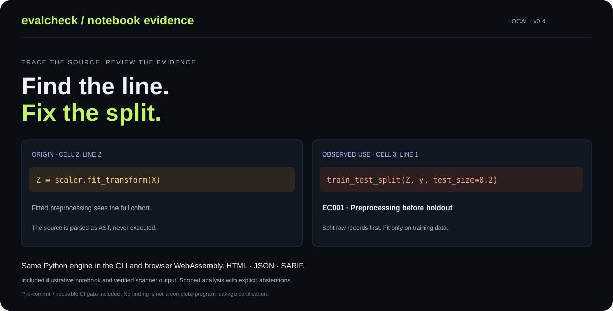

<div align="center">

# EvalCheck

### Find the line. Fix the split.

**Trace evaluation risks in notebooks and data splits — locally, before they reach CI.**

No API keys · No runtime dependencies · No data uploads · Python 3.10+

[Quick start](#quick-start) · [Checks](#what-it-checks) · [Python API](#python-api) · [Methodology](methodology.md) · [한국어](../README.ko.md)



</div>

EvalCheck connects **notebook code locations** and **data-split evidence**. It can trace a fitted preprocessing operation into a later holdout split, identify fitting on held-out arrays, and export the observed flow for review. It also retains the text-split auditor and component-preserving proposals.

Run the Python CLI or open the browser-local demo. Both use the **same Python engine**, with no server upload of your inputs. Inspected notebook/source code is parsed as AST and is never executed. Exports include standalone HTML, JSON and SARIF for code findings.

> **Status: v0.5.0, pre-release.** This source distribution has not been published to PyPI. `evalcheck-local` is a provisional distribution name; the CLI is `evalcheck`. This is a scoped lexical audit, not a certification that an evaluation is leakage-free.

## Inspect a notebook in one command

```bash
python -m pip install .
evalcheck scan examples/notebooks/leaky.ipynb --out my-code-audit --fail-on none
```

Open `my-code-audit/report.html`: it traces the fitted scaler at **cell 2, line 2** into the split at **cell 3, line 1**, and flags fitting the estimator on test records at **cell 3, line 3**. The corrected notebook is included for comparison.

The browser app is `web/index.html`; download/open it in a modern browser or host it as static files. The first scan downloads a pinned Python WebAssembly runtime; it is not fully offline-first. [Browser usage and limits](../web/README.md).

| Code rule | Observed pattern |
|---|---|
| EC001 | Fitted preprocessing flows into a holdout split |
| EC002 | A known estimator fits tracked held-out records |
| EC003 | Prefitted features flow into cross-validation/search |
| EC004 | Resampling flows into a holdout split |

This is scoped static analysis, not a complete leakage proof. Function bodies, control flow and opaque helpers can be missed; coverage notes and explicit abstentions are part of the result. [Scope and supported APIs](notebook-scan.md).

## Evidence beyond a screenshot

- **Observed consequence:** on ten fixed independent noise datasets, feature selection fitted before splitting yields mean test accuracy **79.5%**, versus **51.6%** with a training-only Pipeline on identical test rows. The scanner identifies that supported source pattern. This is a labelled synthetic negative control, not a real-world effect estimate or model-quality improvement. [Plan and every seed](../examples/notebooks/README.md).
- **Frozen authored challenge:** 40 cases; 20 risks detected, 4 missed, 16 safe cases unflagged. Overall recall includes the unsupported risks. This is not independent real-world precision/recall. [All labels, misses and hashes](benchmarks/notebooks/README.md).
- **One engine:** a WebAssembly/CPython parity check compares all 40 decisions, both notebook presets and the complete 3,000-record public-data summary. [Reproduction script](tools/check_wasm.cjs).
- **Adoption path:** pre-commit entry point, repository-local composite GitHub Action and HTML/JSON/SARIF exports. [Integration recipes](integrations.md). Hosted GitHub execution/upload has not been verified.

## A real-data case you can reproduce

On all **3,000 UCI Sentiment Labelled Sentences** records, our fixed seed-42 row-random split has **7 exact-overlap clusters, 7 lexical-near pairs and 25 unique involved rows**. A connected-component proposal preserves all records and has zero such cross-split findings at the same threshold.

These are our generated protocols, not official benchmark splits. No classifier was trained, and the results do not establish score inflation. [Read the case study and inspect all outputs](../examples/uci_sentiment/README.md).

```bash
python examples/uci_sentiment/reproduce.py --out my-uci-case
```

This runs offline from the source checkout, verifies original file hashes, and writes the three protocols' reports and manifests. Dataset text and labels are [CC BY 4.0](../THIRD_PARTY_NOTICES.md), separate from the software license.

## Quick start

From this repository directory:

```bash
python -m pip install .
evalcheck demo --out my-demo
```

Open `my-demo/report.html` in a browser. The demo contains **intentionally planted synthetic issues**, not findings from a real benchmark.

Audit your own files:

```bash
evalcheck audit \
  --split train=data/train.csv \
  --split test=data/test.csv \
  --text answer --label grade --group question_id \
  --out my-audit
```

The default CI policy returns exit code `1` if an error-level overlap is found. **The report is still written.** To inspect without failing on findings, add `--fail-on none`. An incomplete search always returns `3`.

No installation alternative:

```bash
PYTHONPATH=src python -m evalcheck demo --out my-demo
```

Output directories must be empty to avoid accidentally replacing previous audits.

## What it checks

| Check | Evidence | Default severity |
|---|---|---|
| Exact text overlap | NFKC-normalized, casefolded, whitespace-collapsed text in multiple splits | Error |
| Near text overlap | Cross-split pairs at or above token-set Jaccard threshold | Warning |
| Shared isolation group | A configured question, patient, document or other group in multiple splits | Error |
| Conflicting labels | Different labels for identical normalized text, including within one split | Warning |

**Errors are configurable evaluation-policy failures, not a conclusion that a dataset is invalid.** A question overlap is appropriate for some known-question tasks and inappropriate for others. Text-identical answers can legitimately have different grades when the question differs.

The report includes:

- Per-split counts of unique rows involved in any overlap check.
- Search, finding-type and severity filters, with paginated evidence cards.
- Exact source split and 1-based data-row position for every finding.
- Similarity values, explicit search coverage and audit fingerprint.
- Export to JSON, without remote JavaScript, fonts, analytics or model calls.

Exact matches are counted as **clusters**; near matches are **pairs**. Overlapping checks do not double-count affected rows. Label conflicts alone do not count as split-overlap rows.

## File contract

CSV headers must be unique. JSONL must contain one object per nonblank line. Text must be a nonblank string. Labels and groups, when enabled, must be nonblank strings or finite numbers; null values are rejected rather than silently ignored.

```csv
answer,grade,question_id
"An enzyme lowers activation energy.",correct,bio-04
"The catalyst is consumed.",incorrect,chem-07
```

Use `--id-column source_id` to preserve a source filename/line or another stable identifier in each finding. Use `--no-label` for unlabeled datasets. Use repeated `--split` options for train, development, test or other named sets. CSV values are strings; JSONL scalar types are preserved, so `1` and `"1"` are distinct labels/groups.

## Python API

```python
from evalcheck import AuditConfig, audit, load_records, write_report

result = audit(
    {"train": load_records("train.csv"), "test": load_records("test.csv")},
    AuditConfig(text="answer", label="grade", group="question_id"),
)
write_report(result, "report.html")
print(result["status"], result["summary"]["counts"])
```

The input rows are not modified. Audit JSON has schema version `1.1`. See [the output contract](output-contract.md).

## Propose a fresh split

```bash
evalcheck split data/all.jsonl \
  --group question_id --test-fraction 0.2 --seed 42 \
  --out proposed-split
```

This creates `train.jsonl`, `test.jsonl`, a row-to-component assignment manifest and a post-split audit. Connected exact matches, configured groups and above-threshold near matches stay together. **No rows are deleted and no labels are changed.**

The splitter refuses to produce a near-aware proposal if its similarity budget is exhausted. `--exact-only` explicitly opts out of near-match isolation; the post-split audit still checks and reports near overlaps.

This is a **proposal for a new evaluation**, not a repair of a fixed published benchmark. It is not stratified. Large connected components may prevent the requested ratio or make a split impossible. Inspect class balance and whether the resulting holdout answers your intended question. Avoid selecting a seed based on held-out performance.

## Reproduce the group-memorization trap

```bash
python -m pip install '.[experiment]'
python examples/compare_splits.py
```

| Fixed model, five seeds | Mean accuracy |
|---|---:|
| Row-random split | 100.0% |
| Group-held-out split | 43.0% |

These are **measured results on a deliberately constructed synthetic task**: 600 rows, 100 groups, independent random labels per group and group-identifying tokens. Both protocols train on 480 rows and test on 120. The comparison demonstrates the evaluation question changing from familiar groups to unseen groups. It does not estimate real-world inflation or imply every random split is wrong.

Raw per-seed results and dependency versions are in [experiment-results.json](../examples/experiment-results.json). The model configuration is fixed; test performance is not used to select hyperparameters.

## Does a better model actually improve on an audited holdout?

We also trained real sentiment classifiers under a fixed local analysis plan: 1,800 train / 600 development / 600 test, with connected-component isolation and train-only TF-IDF fitting. Development selected a word + character model from three predeclared candidates. Only the baseline and the locked selected candidate were scored on identical test rows.

| Held-out test metric | Word-unigram baseline | Development-selected word + character model |
|---|---:|---:|
| Macro-F1 | 0.7949 | 0.8033 |
| Accuracy | 79.50% | 80.33% |

The Macro-F1 difference is +0.0084, but its paired component-bootstrap 95% percentile interval is **[-0.0164, +0.0320]**. It includes zero: **a small observed gain, not clear evidence of a positive improvement**. The candidates were not changed in response to test results.

This compares feature representations, not EvalCheck's causal effect on accuracy. The tool supplies evaluation controls. [Full model study, plan, predictions and limitations](../examples/uci_sentiment/model_experiment/README.md).

```bash
python -m pip install '.[experiment]'
python examples/uci_sentiment/train_models.py --out my-model-experiment
```

## CI: fail on evidence, preserve the report

```yaml
- run: python -m pip install .
- run: >-
    evalcheck audit --split train=data/train.csv --split test=data/test.csv
    --group question_id --out audit-artifact --fail-on warning
- uses: actions/upload-artifact@v4
  if: always()
  with:
    name: evalcheck-report
    path: audit-artifact/
```

| Exit | Meaning |
|---|---|
| `0` | Complete audit with no finding that violates `--fail-on`, or successful demo/split command |
| `1` | Audit findings violate the selected severity policy |
| `2` | Invalid input, arguments or file operation |
| `3` | Incomplete similarity search, irrespective of severity policy |

## Scope and scale

The near-match engine uses an inverted token index, a token-count bound, and exact Jaccard comparison over remaining candidates. There is no hidden approximate nearest-neighbor step. A default budget of 200,000 comparisons caps similarity computation, **not total indexing or candidate-enumeration cost**. Highly repetitive corpora can still take substantial time and memory. Start with small or moderate text datasets; do not assume this is a web-scale deduplication engine.

A completed lexical search cannot detect semantic paraphrases, time leakage, target-derived features, model-selection leakage or foundation-model pretraining contamination. Word order and word frequency are ignored. Whitespace-poor languages may need a different tokenizer. Full methodology and limitations: [docs/methodology.md](methodology.md).

## Contribute

```bash
python -m unittest discover -s tests -v
```

The tests include a brute-force oracle for randomized near-match retrieval, transitive split-isolation checks, malformed-input cases, CLI policies and HTML injection payloads. See [CONTRIBUTING.md](../CONTRIBUTING.md) for extension guidelines.

Good next contributions: reviewed multilingual fixtures, tokenization adapters, an optional semantic detector, and real public-data case studies with clear licenses. See [the release plan](release-plan.md). A pinned public-data case is included. Independent detection-quality studies and representative throughput benchmarks remain open.

Software: MIT. Bundled UCI text/labels: CC BY 4.0; see [third-party notices](../THIRD_PARTY_NOTICES.md). [Security and reporting](../SECURITY.md).

## English / 한국어

The playground has an English/Korean language selector. It follows the browser language on the first visit and remembers the selection when storage is available. Switching language preserves inputs, filters and the current audit. HTML export uses the selected language without rescanning.

CLI: `evalcheck scan notebooks --out audit-ko --lang ko`. All four commands accept `--lang en|ko` (default `en`). Python report writers accept `lang="ko"`. UI text is localized; source code, record text, identifiers, canonical JSON/SARIF, fingerprints and detection decisions remain unchanged. This does not add multilingual semantic detection.
