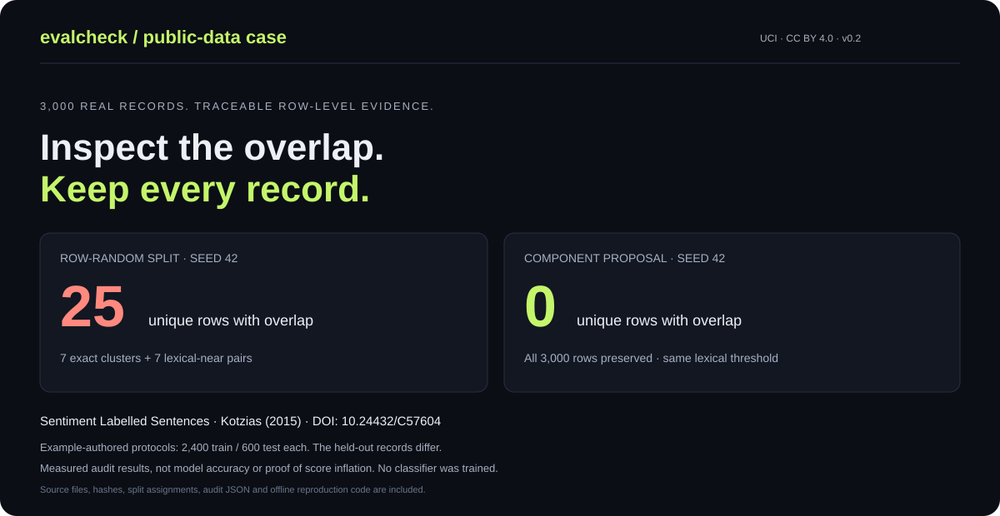

# Public-data case study: 3,000 sentiment-labelled sentences

**A fixed row-random split contains 25 unique rows involved in exact or lexical-near overlap. A fresh connected-component proposal retains all 3,000 records and has zero such cross-split findings at the configured threshold.** These are audit results, not classifier performance results.



## Reproduce offline

From the repository root, with Python 3.10+:

```bash
python examples/uci_sentiment/reproduce.py --out my-uci-case
```

No installation, model, API key or network access is needed. The script checks the SHA-256 and byte size of every bundled source file before parsing it. It writes the three protocols' inputs, audit JSON, standalone HTML reports, a split proposal manifest and a summary. The output folder must be empty.

To use the installed CLI directly:

```bash
python -m pip install .
evalcheck audit \
  --split train=examples/uci_sentiment/results/row-random/train.jsonl \
  --split test=examples/uci_sentiment/results/row-random/test.jsonl \
  --id-column source_id --max-candidates 2000000 \
  --out my-independent-audit --fail-on none
```

## Data and attribution

- Dataset: **Sentiment Labelled Sentences**, donated by Dimitrios Kotzias (2015), [UCI record](https://archive.ics.uci.edu/dataset/331/sentiment+labelled+sentences), [DOI 10.24432/C57604](https://doi.org/10.24432/C57604).
- Related paper: Kotzias, Denil, de Freitas and Smyth, *From Group to Individual Labels Using Deep Features*, KDD 2015.
- UCI lists the dataset under [Creative Commons Attribution 4.0](https://creativecommons.org/licenses/by/4.0/). The dataset is separate from this repository's MIT software license. See [THIRD_PARTY_NOTICES.md](../../THIRD_PARTY_NOTICES.md).
- Retrieved from the official UCI ZIP on 2026-11-06. The three files in `data/` preserve original bytes. The selected files each contain 1,000 records, with 500 positive (`1`) and 500 negative (`0`) labels.
- [source-manifest.json](source-manifest.json) records the download URL, original archive SHA-256, per-file hashes and sizes, creator, license and adaptations.

We use the complete three-file corpus. We add provenance identifiers and explicitly create new splits; we do not claim that the authors supplied the generated train/test partition.

## Protocols and measured results

The lexical threshold is fixed at 0.8 before the case study. All searches completed within a budget of 2,000,000 candidate comparisons. Exact matching is NFKC + casefold + whitespace collapse; near matching uses Unicode word-token-set Jaccard.

| Protocol | Rows / assignment | Exact overlap clusters | Near pairs | Unique overlap rows |
|---|---|---:|---:|---:|
| Original source domains | Amazon 1,000 / IMDb 1,000 / Yelp 1,000 | 1 | 4 | 7 |
| Example-authored row-random split, seed 42 | Train 2,400 / test 600 | 7 | 7 | 25 |
| Example-authored component proposal, seed 42 | Train 2,400 / test 600 | 0 | 0 | 0 |

The source-domain audit inspects cross-source reuse. Its domains are not training and test sets. The row-random protocol uses Python `Random(42)` to shuffle positional indices, with the first 600 assigned to test; original relative order is retained within each output. Seed 42 is the example's fixed choice, not a seed selected for a larger observed effect.

For the row-random protocol, **14 / 2,400 training rows** and **11 / 600 test rows** are involved in at least one overlap finding. The 14 findings must not be confused with the 25 unique involved rows. Exact clusters and near pairs also have different counting units.

The component proposal groups all exact-normalized and above-threshold lexical relationships, including relationships within the original source files. It forms **2,962 components**, with a largest component of **6 rows**. No row or label is removed or changed.

| Label balance | Train negative / positive | Test negative / positive |
|---|---:|---:|
| Row-random split | 1,195 / 1,205 | 305 / 295 |
| Component proposal | 1,203 / 1,197 | 297 / 303 |

The proposal is not stratified. Original and proposed test sets differ. This is **not a controlled comparison of model scores**; no classifier is trained here.

## Interpret the actual evidence

Every finding preserves source filename + physical line number via `source_id`. For example, the random split puts the same `Works great!.` text at `amazon_cells_labelled.txt:525` in training and `amazon_cells_labelled.txt:19` in test. This is a verifiable cross-split text overlap under our generated protocol.

The five original cross-source findings illustrate why lexical matches need interpretation:

| Evidence | Source locations | Interpretation |
|---|---|---|
| Normalized `Very disappointing.` | Amazon 338 / IMDb 106 | Exact normalized phrase shared across domains. A common short phrase; this does not establish copied reviews or invalid author methodology. |
| `don't waste your money and time.` vs a sentence beginning `Horrible -` | Amazon 405 / Yelp 241 | Jaccard 0.875; shared negative wording with additional text. A review candidate. |
| Two versions of `Don't waste your time` | IMDb 838 / Yelp 474 | Jaccard 0.833333; punctuation and an additional word differ. |
| `Very disappointing.` vs `Very disappointing!!!` | Amazon 338 / Yelp 622 | Token-set Jaccard 1.0; punctuation differs, so the exact-text check does not merge them. |
| The same punctuation variant pair across the other source | IMDb 106 / Yelp 622 | The near detector counts pairs; these two findings involve a shared row. |

These explanations are case-study interpretations, not independent expert annotations or a calibrated false-positive study. All five findings have consistent negative labels. No label-conflict finding was observed in any of the three protocols. Labels are preserved as provided.

## What this establishes

The tool can load the full pinned public corpus, expose traceable overlaps, complete its defined lexical search, and propose isolated components without dropping records. Raw outputs and the reproduction script let another developer verify those statements.

It does not establish that the dataset is defective, that a published model score is inflated, that common sentiment phrases must always be held out, or that all types of leakage are absent. A lexical similarity threshold can over-group otherwise valid independent examples and does not detect semantic, temporal or model-selection leakage.

The test suite validates the original byte hashes and record counts, checks a corpus-specific overlap regression, and verifies physical-line parsing with embedded Unicode separators. Broad detection accuracy and web-scale throughput remain unmeasured.
